<!-- ───────────────────────── HEADER ───────────────────────── -->
<p align="center">
  
</p>

<p align="center">
  <a href="https://github.com/mktran76">
    
  </a>
</p>

<p align="center">
  
  
  
  
</p>

---

### 👋 About me

```java
public class Khoi extends Engineer {

    String   role    = "Backend & DevOps Engineer";
    String[] daily   = { "Java 25", "Spring Boot", "Netty", "AWS ECS Fargate", "Terraform" };
    String[] lately  = { "JDK upgrades & build matrices", "CI/CD hardening", "Production monitoring" };
    String[] langs   = { "Tiếng Việt", "English", "日本語 (learning)" };

    String funFact() {
        return "My demo websites exist mostly to be clicked on by heatmaps 🔥";
    }
}
```

---

### 🚪 Pick a door

> Click the one that fits you — each opens something different.

<details>
<summary><b>💼 &nbsp;I'm looking at your profile for work</b></summary>
<br/>

**In one sentence:** I keep the backend of a web-analytics (heatmap & CRO) product fast, up-to-date and boring-in-a-good-way on AWS.

| What I do | How it looks day-to-day |
|---|---|
| ⚙️ **Backend services** | Java / Spring Boot / Netty services that collect and serve heatmap data |
| ☁️ **Cloud & IaC** | ECS Fargate, ECR, Lambda, Step Functions, CloudWatch — all managed with Terraform |
| 🚀 **Delivery** | GitHub Actions pipelines: build, JDK matrix tests, `terraform plan` on PRs, deploy, release notes |
| 🩺 **Reliability** | Reading logs, alarms and metrics so problems are caught before users report them |
| 📸 **Automation** | Headless-browser (Playwright) screenshot services |

```mermaid
flowchart LR
    A([💡 Ticket]) --> B[🌿 Branch & PR]
    B --> C{{🤖 GitHub Actions}}
    C -->|build · test| D[☕ JDK matrix]
    C -->|IaC| E[📝 terraform plan<br/>as PR comment]
    D --> F[🐳 Docker image → ECR]
    E --> G[🏗️ terraform apply]
    F --> H[(☁️ ECS Fargate / Lambda)]
    G --> H
    H --> I[📈 CloudWatch<br/>logs · alarms · metrics]
    I -.feedback.-> A
```

</details>

<details>
<summary><b>🛠️ &nbsp;I'm an engineer — show me how you ship</b></summary>
<br/>



**Things I care about**

- 🔁 **Reproducible builds** — pin the toolchain, test across JDK versions before switching.
- 🧾 **Evidence over opinion** — every fix comes with logs, metrics or a before/after.
- 🧹 **Small PRs, clear history** — one ticket, one purpose, readable commits.

</details>

<details>
<summary><b>🎲 &nbsp;I just want to click something</b></summary>
<br/>

Go on — open a playground below and click around. 👀
These are the sandbox sites I use for **heatmap, A/B and popup experiments**.

| | | |
|:-:|:-:|:-:|
| [🍳 **Chefer**](https://mktran76.github.io/testing-heatmap-AB/) | [🪙 **CryptoCoin**](https://mktran76.github.io/cryptocurrency-website/) | [🏨 **Hotelier**](https://mktran76.github.io/Hotelier/) |
| [🎓 **eLearning**](https://mktran76.github.io/simple-webpage-local/) | [💻 **HighTech**](https://mktran76.github.io/simple-webpage-prod/) | [🌱 **FarmFresh**](https://mktran76.github.io/simple-webpage/) |

</details>

---

### 🧰 Toolbox

<table>
  <tr>
    <td align="center" width="25%"><b>Backend</b></td>
    <td align="center" width="25%"><b>Cloud & IaC</b></td>
    <td align="center" width="25%"><b>Delivery</b></td>
    <td align="center" width="25%"><b>Frontend</b></td>
  </tr>
  <tr>
    <td align="center"></td>
    <td align="center"></td>
    <td align="center"></td>
    <td align="center"></td>
  </tr>
  <tr>
    <td align="center"><sub>Netty · Lombok · JUnit</sub></td>
    <td align="center"><sub>ECS Fargate · ECR · Lambda · Step Functions · CloudWatch</sub></td>
    <td align="center"><sub>JDK matrix · release-note automation</sub></td>
    <td align="center"><sub>Playwright · Bootstrap</sub></td>
  </tr>
</table>

---

### 🌐 Playground projects

<table>
  <tr>
    <td width="50%" valign="top">
      <h4>🍳 <a href="https://github.com/mktran76/testing-heatmap-AB">testing-heatmap-AB</a></h4>
      A 40+ page restaurant site built to test heatmaps and A/B variants on many page types.<br/><br/>
      <a href="https://mktran76.github.io/testing-heatmap-AB/"></a>
      
    </td>
    <td width="50%" valign="top">
      <h4>🪙 <a href="https://github.com/mktran76/cryptocurrency-website">cryptocurrency-website</a></h4>
      A crypto landing site with 30+ pages — market, wallet, staking, roadmap — styled with SCSS.<br/><br/>
      <a href="https://mktran76.github.io/cryptocurrency-website/"></a>
      
    </td>
  </tr>
  <tr>
    <td width="50%" valign="top">
      <h4>🎓 <a href="https://github.com/mktran76/simple-webpage-local">simple-webpage-local</a> · 💻 <a href="https://github.com/mktran76/simple-webpage-prod">-prod</a></h4>
      A pair of sites mirroring <i>local</i> and <i>prod</i> environments, used to try tracking and popup settings safely.<br/><br/>
      <a href="https://mktran76.github.io/simple-webpage-local/"></a>
      <a href="https://mktran76.github.io/simple-webpage-prod/"></a>
    </td>
    <td width="50%" valign="top">
      <h4>🏨 <a href="https://github.com/mktran76/Hotelier">Hotelier</a> · 🌱 <a href="https://github.com/mktran76/simple-webpage">simple-webpage</a></h4>
      A hotel booking site and an organic-farm shop — small, realistic layouts for quick experiments.<br/><br/>
      <a href="https://mktran76.github.io/Hotelier/"></a>
      <a href="https://mktran76.github.io/simple-webpage/"></a>
    </td>
  </tr>
</table>

---

### 📊 Activity

<p align="center">
  <picture>
    <source media="(prefers-color-scheme: dark)" srcset="https://streak-stats.demolab.com?user=mktran76&theme=dark&hide_border=true&background=0D1117&ring=D9739A&fire=D9739A&currStreakLabel=D9739A"/>
    
  </picture>
</p>

<details>
<summary><b>📈 &nbsp;Show my contribution graph</b></summary>
<br/>
<picture>
  <source media="(prefers-color-scheme: dark)" srcset="https://github-readme-activity-graph.vercel.app/graph?username=mktran76&bg_color=0D1117&color=c9d1d9&title_color=D9739A&line=D9739A&point=ffffff&area=true&area_color=D9739A&hide_border=true"/>
  
</picture>
</details>

<p align="center">
  <picture>
    <source media="(prefers-color-scheme: dark)" srcset="https://raw.githubusercontent.com/mktran76/mktran76/output/github-snake-dark.svg"/>
    
  </picture>
</p>

<!-- ───────────────────────── FOOTER ───────────────────────── -->
<p align="center">
  
</p>
